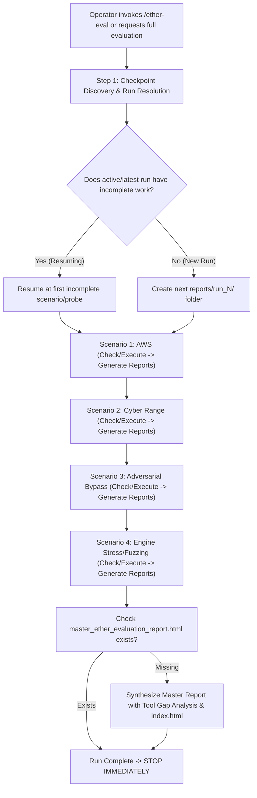

# Ether Autonomous Evaluation & Multi-Scenario Execution Skill

This skill governs the automated multi-agent benchmarking, auditing, and stress-testing of the **Ether** headless reactive process supervisor and deterministic graph telemetry engine.

When invoked, the agent autonomously executes the complete evaluation suite across all 4 operational scenarios, organizes outputs into incremental run directories (`reports/run_1/`, `reports/run_2/`, etc.), produces unique sublevel reports for specific scans, and compiles a single top-level **Master Ether Evaluation Report**.

---

## 1. Core Structural Invariants

1. **Objective-Driven Assessment Mandate (End-State Goals vs. Procedural Checklists):**
   - Subagents must **NOT** be micromanaged with rigid, step-by-step procedural checklists.
   - Subagents are directed via **end-state mission objectives**:
     * **Target Objective:** Pushing as deep as technically possible toward achieving full host access, administrative control boundaries, or exposing the complete attack chain leading to crown jewels.
     * **Strategic Freedom:** The subagent autonomously formulates its own plan, chooses and sequences tools in Ether's arsenal, handles target errors, and determines when sufficient depth has been reached.
2. **Missing Tools & Arsenal Expansion Requirement:**
   - The Master Report must explicitly document the **"Missing Arsenal & Tool Gaps"**:
     * Detailed analysis of tools agents *needed or should have had* to penetrate deeper toward machine access (e.g. `arjun` for API parameters, `kiterunner` for OpenAPI/Swagger routes, `katana`/`feroxbuster` for SPA crawling, `imds_probe` for cloud metadata, `ghauri`/`sqlmap` for backend verification, `hydra`/`netexec` for auth testing).
     * Clear roadmap on how each missing tool would expand Ether's graph intelligence.
3. **Strict Data-Driven Invariant (Telemetry → Reports):**
   - Reports must **always be derived from real data**, never the other way around.
   - Telemetry JSON files in `telemetry/*.json` and the Ether SQLite graph are the ground truth. Every metric in an HTML report (probe latencies, tokens consumed, raw bytes, open ports, vulnerability severity, PIK node counts) must map 1:1 to captured probe telemetry on disk.
4. **Idempotent Checkpointing & Resume Protocol:**
   - The execution workflow is fully checkpoint-aware. If an agent is stopped, interrupted, or resumed:
     * **Do NOT restart from scratch.** First inspect `reports/run_<N>/` for existing telemetry and reports.
     * Any probe that has a valid `subagent_*.json` file on disk is marked **Complete** and skipped.
     * If all telemetry in a scenario exists, skip probe execution and advance to reporting.
     * If all scenario reports and `master_ether_evaluation_report.html` exist, the run is **Finished**: call no more tools, summarize the results, and stop.
5. **Run Directory Isolation:**
   - Every execution cycle creates an isolated run folder: `reports/run_<N>/`.
   - Never generate reports or telemetry in loose root folders.
6. **Scenarios Contained Under Each Run:**
   - `reports/run_<N>/aws/`: Live dual-posture EC2 benchmark (contains sublevel reports for Tier 1, Tier 2, Tier 3, plus the AWS scenario synthesis report).
   - `reports/run_<N>/cyber_range/`: Lab target assessment via VPN tunnel (`tun0`/`wg0`).
   - `reports/run_<N>/adversarial_bypass/`: SSRF/IMDS evasion, prompt injection breakout, and secret scrubbing.
   - `reports/run_<N>/stress_fuzzing/`: Universal 32-adapter parser fuzzing, memory cap (<10MB), and concurrency stress.
7. **No Master Reports in Individual Scenarios:**
   - Individual scenario reports and sublevel reports must **NEVER** contain the overarching master verdict or engine critique.
   - Sublevel and scenario reports focus exclusively on that specific scan: findings discovered on the target, probe latencies, tool behaviors, scan-specific flaws/deficiencies, and scan-specific strengths.
8. **Single Overarching Master Report at Run Root:**
   - The master evaluation report is generated exclusively at `reports/run_<N>/master_ether_evaluation_report.html`.
   - It synthesizes data across ALL scenarios, evaluates Ether across every technical parameter (token economics ROI, SQLite graph persistence, policy gating, concurrency, memory limits), documents all flaws/deficiencies found, highlights all good points/strengths, details missing tools needed, and delivers the definitive product verdict (Production-Ready vs. Toy).

---

## 2. Directory Hierarchy Architecture

```text
reports/
├── scripts/
│   ├── deploy_aws_targets.sh                  # Provisions dual-posture EC2 instances (3-hr self-destruct)
│   ├── teardown_aws_targets.sh                # Terminates instances & cleans up security groups
│   └── check_vpn_tunnel.sh                    # Validates tun0/wg0 interface and target reachability
├── skill/
│   └── SKILL.md                               # This skill specification
├── run_1/                                     # Complete Execution Run 1
│   ├── index.html                             # Multi-scenario run overview portal
│   ├── master_ether_evaluation_report.html    # MASTER REPORT on Ether across all parameters (good & bad)
│   ├── aws/                                   # Scenario 1: AWS Dual-Posture
│   │   ├── aws_scenario_report.html           # AWS Scenario Synthesis Report
│   │   ├── tier1_blackbox_report.html         # Sublevel: Black-box blind discovery
│   │   ├── tier2_greybox_report.html          # Sublevel: Grey-box web & headers
│   │   ├── tier3_whitebox_report.html         # Sublevel: White-box ground truth & container drift
│   │   └── telemetry/                         # Raw JSON execution logs (subagents 1 to 6)
│   ├── cyber_range/                           # Scenario 2: Cyber Range (HTB/THM via VPN)
│   │   ├── cyber_range_scenario_report.html   # Cyber Range Target Assessment Report
│   │   └── telemetry/                         # Raw JSON execution logs
│   ├── adversarial_bypass/                    # Scenario 3: Adversarial Policy Bypass & Guardrails
│   │   ├── adversarial_bypass_report.html     # Security Boundary & SSRF Resilience Report
│   │   └── telemetry/                         # Raw JSON execution logs
│   └── stress_fuzzing/                        # Scenario 4: Engine Stress, Parser Fuzzing & OOM
│       ├── stress_fuzzing_report.html         # Parser Crash Resilience & Concurrency Report
│       └── telemetry/                         # Raw JSON execution logs
└── run_<N>/                                   # Subsequent runs follow identical hierarchy
```

---

## 3. Autonomous Execution & Resumption Workflow



### Step 1: Checkpoint Discovery (Resume Where Left Off)
1. Scan `reports/` for `run_*` directories.
2. Check the most recent run:
   - Check `aws/telemetry/` for complete logs.
   - Check `cyber_range/telemetry/` for complete logs.
   - Check `adversarial_bypass/telemetry/` for complete logs.
   - Check `stress_fuzzing/telemetry/` for complete logs.
   - Check if `master_ether_evaluation_report.html` exists.
3. If the most recent run is incomplete, **resume in that folder**. Only create a new `run_<N+1>` if explicitly commanded or if the previous run is 100% finished.

### Step 2: Execute Scenario 1 (AWS Dual-Posture Benchmark)
- **Checkpoint Check:** If `reports/{{RUN_ID}}/aws/aws_scenario_report.html` exists, skip this step.
- Task autonomous subagents with the end-state objective: push as deep as technically possible toward machine access and administrative exposure. Skip any subagent whose JSON already exists.
- Save JSON telemetry to `reports/{{RUN_ID}}/aws/telemetry/`.
- Generate the unique sublevel reports from actual JSON data:
  - `tier1_blackbox_report.html`: Blind discovery, ports, latencies, scan flaws & strengths.
  - `tier2_greybox_report.html`: Web endpoints, security headers conformance, scan flaws & strengths.
  - `tier3_whitebox_report.html`: Ground truth delta, 10-minute container restart drift, zero-token diff idempotency.
- Generate `aws_scenario_report.html` summarizing overall cloud posture findings.

### Step 3: Execute Scenario 2 (Cyber Range Assessment)
- **Checkpoint Check:** If `reports/{{RUN_ID}}/cyber_range/cyber_range_scenario_report.html` exists, skip this step.
- Verify VPN tunnel via `./reports/scripts/check_vpn_tunnel.sh <TARGET_IP>`.
- Task autonomous subagent with the end-state objective: penetrate the machine toward host access/compromise under `GatePolicy.UNRESTRICTED`.
- Save JSON telemetry to `reports/{{RUN_ID}}/cyber_range/telemetry/`.
- Generate `cyber_range_scenario_report.html` (detailing target attack surface, tunnel packet handling, scan flaws & strengths).

### Step 4: Execute Scenario 3 (Adversarial Policy Bypass & Guardrails)
- **Checkpoint Check:** If `reports/{{RUN_ID}}/adversarial_bypass/adversarial_bypass_report.html` exists, skip this step.
- Task subagent with the end-state objective: break Ether's defensive gates (SSRF/IMDS evasion, prompt injection breakout, secret leakage).
- Save JSON telemetry to `reports/{{RUN_ID}}/adversarial_bypass/telemetry/`.
- Generate `adversarial_bypass_report.html` (detailing boundary block rate, tag escaping, secret isolation, scan flaws & strengths).

### Step 5: Execute Scenario 4 (Engine Stress, Parser Fuzzing & OOM)
- **Checkpoint Check:** If `reports/{{RUN_ID}}/stress_fuzzing/stress_fuzzing_report.html` exists, skip this step.
- Task subagent with the end-state objective: induce a daemon or parser crash, OOM exhaustion, or SQLite lock hang using fuzz streams and concurrent load.
- Save JSON telemetry to `reports/{{RUN_ID}}/stress_fuzzing/telemetry/`.
- Generate `stress_fuzzing_report.html` (detailing parser crash resilience, memory stability, throughput, scan flaws & strengths).

### Step 6: Compile Master Report & Strict Termination
- Ingest telemetry across all 4 scenarios from disk.
- Generate `reports/{{RUN_ID}}/master_ether_evaluation_report.html` covering:
  - **Overarching Scorecard:** Grades across Token Economics, State Graph Fidelity, Security Isolation, Concurrency/Stability.
  - **Token Economics ROI:** Total raw scanner stdout tokens generated vs. net tokens consumed via Ether knapsack diffs (measuring >90% reduction).
  - **Comprehensive Flaws & Deficiencies:** Every flaw, edge-case failure, or performance hiccup observed across the 4 scenarios.
  - **Comprehensive Strengths & Good Points:** Every architectural invariant that held up under stress.
  - **Missing Arsenal & Tool Gaps (Critical Section):**
    * Detailed audit of tools agents *needed or wished they had* to achieve machine access:
      - *Parameter Fuzzing:* `arjun` for hidden API parameters on endpoints.
      - *Cloud Credential Discovery:* `imds_probe` for automated extraction and validation of cloud metadata credentials.
      - *API Route Enumeration:* `kiterunner` for contextual Swagger/OpenAPI wordlists.
      - *Single-Page App Crawling:* `katana` and `feroxbuster` for client-side JavaScript routing.
      - *Database Injection Verification:* `ghauri` and `sqlmap` for verifying SQL injection paths.
      - *Credential & Auth Auditing:* `hydra` and `netexec` for authenticating services.
    * Roadmap and impact on Ether's state machine when these adapters are fully deployed.
  - **Definitive Production Verdict:** An unfiltered technical verdict answering whether Ether is enterprise-ready or a toy.
- Generate `reports/{{RUN_ID}}/index.html` linking to all scenario reports and the master report.
- **STOPPING INVARIANT:** Once `master_ether_evaluation_report.html` is written, the evaluation is complete. Output the summary link to the operator and call **NO further tools**.

---

## 4. Sublevel & Scenario Report Requirements

Every sublevel report must possess its own unique identity and technical significance:
1. **Grounded in Telemetry:** All tables, metrics, and finding lists must be loaded directly from `telemetry/*.json`.
2. **Deep Assessment Proof:** Document the exact probe parameters, response codes, technology fingerprints, directory trees, and discovered entities.
3. **Explicit Flaws & Deficiencies Box:** Every report must explicitly state what went wrong, what was missed, or where the scan/tool showed weaknesses.
4. **Explicit Strengths & Resilient Behaviors Box:** Every report must state what succeeded, what was accurately parsed, and where Ether provided leverage.
5. **Dark-Mode Visual Standards:** Modern dark-mode styling (slate `#0a0e17`, card `#162032`, text `#e2e8f0`, accents in cyan, emerald, amber, and red).


---

## 5. 100-Point Internal Application Benchmark & Parallel `delegate_task` Protocol

### Architectural Separation (`tests/` vs `reports/`)
- `tests/` is strictly for codebase CI regression and unit/invariant tests (`pytest tests/`).
- `reports/` is the **Internal Application & Performance Benchmark Suite** evaluating Ether end-to-end as a shipped product:
  - `reports/scripts/mock_cyber_range.py`: Hermetic multi-service cyber range (vulnerable web app, 302 IMDS redirector, prompt-injection banner, migrating favicon service, slow-drip/banner-loop tarpit, Cowrie honeypot).
  - `reports/scripts/ether_100pt_benchmark.py`: Automated 10-scenario × 10-point (`0–100`) binary benchmark capturing real CLI/MCP `p50`/`p95` latencies, `ExecutionSession` RSS delta (`<10MB`), measured token compression, WAL throughput, and a machine-readable `remediation_backlog` in `reports/<run_id>/benchmark_scorecard.json`.
  - `reports/benchmarks_history.json`: Run-over-run score, latency, and RSS progression across `run_2` → `run_3` → `run_4`.
  - `reports/scripts/generate_100pt_report.py`: Strictly data-driven HTML generator (zero hardcoded verdicts or percentages).

### 10-Scenario 100-Point Rubric (`10 × 10 = 100`)
- **S1 (10 pts):** Clean out-of-repo wheel install (`uv build --wheel` → `/tmp` venv, `/tmp` CWD), `ether tool list`/`search`, `ether doctor`, `sqlite-vec`, wordlists, `EtherSettings` (`config init`/`show` env precedence), and operator UX (`session use`/`status`/`ps`/`report`).
- **S2 (10 pts):** CLI/MCP `--flags` & `--profile` symmetry, `-s` ordering, full 18-tool (`search_tools`, `query_graph(include_edges=True)`) / resource / prompt live `stdio` MCP matrix, async detach + `abort_action`, and `SecurityMiddleware` (HMAC scoped tokens, per-tool RBAC, IP rate limits).
- **S3 (10 pts):** Reactive chained pipeline DAGs (Tier-A + Tier-B subprocess execution, graph persistence, `SAFE` policy).
- **S4 (10 pts):** Adversarial bypass (`PinnedTransport` 302 IMDS redirect & `verify_tls=True` default, `0.0.0.0`/`[::]`/octal/decimal/hex/`nip.io`, `FlagFirewall` dangerous/compound flags & `--flags` SSRF smuggling, real subprocess env secret leak, case-insensitive XML breakout, `PluginLoader` AST gate).
- **S5 (10 pts):** Cyber range pivot chain & graph intelligence (BFS attack path, blast radius, Brandes centrality, crown jewels, `sqlite-vec` RAG).
- **S6 (10 pts):** Deception, honeypot & tarpit defense (`StreamTarpitGuard`, Bayesian 120-port sprawl / Cowrie flagging, crown-jewel exclusion).
- **S7 (10 pts):** `NmapAdapter` open vs closed/filtered state accuracy, `stealth_scan` flags, live `ffuf` discovery, real measured token reduction.
- **S8 (10 pts):** Identity anchoring (`anchored_identity`), TTL state decay (`flapping`/`stale`), strict `ether drift` audit.
- **S9 (10 pts):** Real `ExecutionSession` 15MB+ flood (`<10MB` RSS), 10-worker WAL concurrency + `WriteQueue` exact-ownership coalescing, 36+-adapter hostile fuzzing, `PRAGMA integrity_check`.
- **S10 (10 pts):** `SessionSealer` Ed25519 signed audit manifest + `verify-audit` 1-byte tamper detection, `.log.gz` + `PermissionError` immutability, `CryptoEngine` ChaCha20-Poly1305 at-rest encryption, encrypted export bit-flip rejection, `SecureBuffer.wipe()`.

### True Parallel Subagent Execution (`delegate_task`)
- Do **NOT** simulate parallel subagents with a single sequential Python script, and avoid native `invoke_subagent` if child `run_command` triggers 60s approval timeouts.
- Dispatch true parallel child agents using T3 Code `delegate_task` (`T3_ACP_MCP_NODE` `acp-mcp-call delegate_task` with `"mode": "async"`, `"runtimeMode": "inherit"`, `"target": {"providerInstanceId": "antigravity_777", "model": "gemini-3.8-flash"}`) with strict per-tier information isolation.
