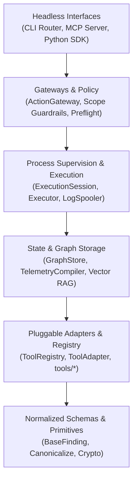

# Ether System Architecture & Engineering Blueprint

Welcome to the authoritative system architecture specification for Ether. This document details the engineering design, modular subsystems, execution pipelines, variable substitution mechanics, plugin discovery lifecycle, architectural decision records (ADRs), and governance rules that define the platform.

---

## 1. Core Philosophy: The Smart-Adapter Substrate

Ether is a headless reactive process supervisor, AST validator, and deterministic graph telemetry engine for cybersecurity tooling and autonomous AI agents. It is engineered to solve a pervasive industry problem: **tool fragmentation, cognitive noise, and context window exhaustion**. In traditional workflows, security practitioners and AI agents run disparate CLI tools (`nmap`, `gobuster`, `nikto`, `whois`, `subfinder`, `dnspython`, `searchsploit`, `ffuf`, `nuclei`, `sqlmap`, `netexec`) that emit incompatible text, XML, and JSON outputs, requiring brittle ad-hoc parsing.

Ether solves this through a **"Smart Adapter / Simple Core"** architecture:

```text
┌────────────────────────────────────────────────────────────────────────┐
│                   APPLICATIONS & AGENTS (Consumers)                    │
│                                                                        │
│  [Autonomous AI Agents]        [Power Red-Teams]     [Pedagogical TUIs]│
│    (Cursor, Claude, MCP)          (Workstation)         (CyGuide)      │
└────────────┬────────────────────────────┬───────────────────────┬──────┘
             │                            │                       │
             ▼                            ▼                       ▼
┌────────────────────────────────────────────────────────────────────────┐
│               HEADLESS INTERFACES (CLI, MCP, Python SDK)               │
├────────────────────────────────────────────────────────────────────────┤
│                       GATEWAYS & SECURITY POLICY                       │
│  - ActionGateway (GatePolicy.SAFE vs GatePolicy.UNRESTRICTED)          │
│  - CIDR Scope Containment, SSRF & Cloud Metadata Defense               │
├────────────────────────────────────────────────────────────────────────┤
│                     CORE EXECUTION & SUPERVISION                       │
│  - ExecutionSession (Asyncio Subprocess & Native Tier A Coroutines)    │
│  - LogSpooler (64KB buffered disk stream), RingBuffer (<10MB RAM cap)  │
│  - Subprocess Environment Secret Scrubbing (sanitize_subprocess_env)   │
├────────────────────────────────────────────────────────────────────────┤
│                      STATE & GRAPH STORAGE (SQLite)                    │
│  - GraphStore (Deterministic SHA-256 PIKs, Idempotent Upsert, WAL)     │
│  - Temporal State Decay (TTL Windows: confirmed -> flapping -> stale)   │
│  - Invariant Identity Anchoring (TLS/SSH/Favicon Cryptographic Hashes) │
│  - Embedded Offline Vector Memory & Finding RAG (sqlite-vec vec0)      │
│  - GraphTelemetryCompiler (Knapsack Token Budgeting & Zero-Token Diffs)│
│  - GraphAnalyticsEngine (Attack Paths, Blast Radius, Centrality)       │
├────────────────────────────────────────────────────────────────────────┤
│                     PLUGGABLE TOOL ADAPTERS (tools/*)                  │
│  - Tier A: In-process async coroutines (http_probe, dnspython)         │
│  - Tier B: Binary subprocesses (nmap, nuclei, ffuf, etc.)              │
├────────────────────────────────────────────────────────────────────────┤
│                   NORMALIZED SCHEMAS & PRIMITIVES                      │
│  - BaseFinding, NetworkHost, NetworkService, WebEndpoint, VulnFound    │
│  - Canonicalization, SecureBuffer, AES-256-GCM + Argon2id Crypto       │
└────────────────────────────────────────────────────────────────────────┘
```

### Key Architectural Invariants:
1. **Strict Headless Invariant**: Ether contains **zero UI code, zero Textual imports, and zero presentation widgets**. Ether is a headless engine, not an application.
2. **Additive Extensibility**: Adding support for a new security tool never requires modifying core engine, database, or API code. An author simply adds a standalone directory under `tools/` containing a `manifest.toml` and `adapter.py`.
3. **Deterministic Canonicalization**: Raw tool outputs are sanitized syntactically before ingestion, ensuring uniform IP addresses, lowercased domains, and normalized URL endpoints.
4. **Strict Encapsulation & Deep Modules**: Interface simplicity hides significant internal complexity. Private connection pools, ring buffers, and session states are never leaked across layer boundaries.

---

## 2. The Supervisory Runtime Model for Cybersecurity Tooling

Ether treats cybersecurity operations through the lens of supervisory runtime design. Traditional security orchestration attempts to solve coordination via brittle shell scripts, monolithic wrappers, or presentation-heavy GUIs/TUIs. Ether rejects this approach in favor of a true **supervisory substrate**:

| Supervisory Concept | Ether Implementation | Architectural Function |
| :--- | :--- | :--- |
| **Process Scheduler & Lifecycle** | `ExecutionSession` & `Executor` | Spawns binaries via pure argument vectors (`asyncio.create_subprocess_exec`), enforces process tree lifecycle, and manages automated `SIGTERM` $\to$ `SIGKILL` escalations. Zero `shell=True`. |
| **Memory Management & Limits** | `LogSpooler` & Bounded Ring Buffer | Enforces hard memory ceilings (<10MB RAM per job) using `deque(maxlen=5000)` while streaming raw GBs of output to disk in 64KB chunks. Sanitizes memory with `wipe_credentials()`. |
| **Device Drivers** | Pluggable Smart Adapters (`tools/*`) | Translates disparate CLI outputs (Nmap XML, FFUF JSON, Nikto text) into uniform, typed Pydantic findings via `ToolAdapter` (Tier A coroutines & Tier B subprocesses). |
| **Filesystem & Inodes** | Deterministic `GraphStore` (SQLite WAL) | Mathematical Primary Identity Keys (PIK) hash into deterministic SHA-256 Node IDs ($H(\text{schema} + \text{sorted\_pik})$), guaranteeing idempotent upserts and relational integrity. |
| **Access Control & Security Rings** | `ActionGateway` & `GatePolicy` | Policy enforcement: `GatePolicy.SAFE` (SSRF defense, link-local & cloud IMDS blocking, CIDR boundaries) vs `GatePolicy.UNRESTRICTED` (unconstrained execution for authorized red-teams). |
| **Hardware Migration & Anchoring** | Invariant Cryptographic Anchoring | Decouples volatile IPs from logical services via TLS (`tls:<sha256>`), SSH (`ssh:<fingerprint>`), and Favicon (`favicon:<hash>`) fingerprints, auto-wiring cross-IP migration edges. |
| **Temporal Confidence Engine** | State Decay TTL Windows | Automatically transitions finding confidence from `confirmed` $\to$ `flapping` $\to$ `stale` based on observation timestamps. |
| **Embedded Acceleration** | Zero-Egress Vector Memory (`sqlite-vec`) | 384-dimensional unit vector engine inside SQLite for sub-millisecond semantic search and finding RAG without external model downloads or network egress. |
| **System Calls & IPC** | Model Context Protocol & SDK | Headless interfaces for userland consumers (AI agents, operators, CLI, custom applications). |
| **Audit Subsystem & dmesg** | Append-Only Event Log & Zero-Token Diffs | Cryptographic audit trail and set-theoretic delta computation ($\Delta = S_{t+1} \setminus S_t$) eliminating 98% of LLM context window bloat. |

---

## 3. Unidirectional Layer DAG

Dependencies flow strictly downwards in one direction:



---

## 3. Domain Model & Core Terminology

* **Finding (`BaseFinding`)**: The atomic unit of intelligence in Ether. Inherits from Pydantic `BaseModel` and encapsulates schema classification, Primary Identity Keys, payload data, parent links, and associations.
* **Schema**: A formal Pydantic contract in `ether/schemas/` defining the data fields and identity rules for an entity type (e.g., `network.host`, `network.service`, `web.endpoint`).
* **Primary Identity Key (PIK)**: The deterministic set of identifying fields for a schema (e.g., `{"ip": "192.168.1.1"}` for `network.host`). Used to generate deterministic SHA-256 Node IDs for deduplication and upserts.
* **Workspace**: The root operational container for an engagement (e.g., "Corporate Audit 2026"). Contains multiple sessions and global graph rollups.
* **Session**: A specific thread of investigation within a workspace isolating findings, active background processes, and action history.
* **Entity Graph**: A persistent directed graph representing the current target state for a session. Built using parent-child edges and semantic association links.
* **Event Log**: An append-only, immutable audit trail of every executed tool action, raw shell command, and generated finding. Ensures full forensic reproducibility.
* **Zero-Token Diff**: The set-theoretic delta ($\Delta = S_{t+1} \setminus S_t$) returned to AI agents, eliminating the need to consume LLM context windows on raw console noise.
* **Vector Memory & Finding RAG**: Embedded 384-dimensional offline semantic vector embeddings (`sqlite-vec` virtual table `vec_findings`) enabling natural language similarity search and task-directed context retrieval.

---

## 4. The Layered Execution Pipeline

To enable autonomous AI agents without compromising safety, Ether implements a strict layered execution pipeline:

```text
[ 1. Consumer / Agent Layer ]
  Submits ActionRequest(tool="nmap", params={"raw_flags": "-sV"}, target="192.168.1.50")
  
[ 2. ActionGateway & Policy Enforcement ]
  - Evaluates GatePolicy (SAFE vs UNRESTRICTED)
  - Validates target against engagement CIDR scope
  - Blocks cloud metadata (169.254.169.254, AWS IMDSv2, GCP, Azure)
  
[ 3. ToolRegistry & Adapter Resolution ]
  - Locates adapter in tools/nmap/
  - Validates binary installation on PATH
  - Constructs safe argument vector (List[str], zero shell=True)
  
[ 4. ExecutionSession & Subprocess Isolation ]
  - Scrubs host secrets via sanitize_subprocess_env()
  - Spawns subprocess via asyncio.create_subprocess_exec()
  - Streams stdout to 64KB disk spooler (data/logs/{action_id}.log)
  - Maintains bounded in-memory ring buffer (<10MB RAM)
  
[ 5. Stream Parsing & Graph Ingestion ]
  - Adapter streamingly yields normalized BaseFinding subclasses
  - Computes deterministic SHA-256 PIK Node IDs
  - Ingests into GraphStore (idempotent upsert, auto-wires parent/assoc edges)
  - Synchronizes 384-d vector embeddings in vec_findings
  - Emits real-time reactive events to attached callbacks / MCP clients
```

---

## 5. Security & Isolation Invariants

1. **Process Isolation & Pure Argument Vectors**:
   - Commands are constructed strictly as argument vectors (`List[str]`). Under no circumstances is `shell=True` or raw shell string interpolation permitted.
2. **Environment Secret Scrubbing**:
   - `sanitize_subprocess_env()` scrubs all cloud, provider, and VCS secrets (`ETHER_*`, `AWS_*`, `GITHUB_*`, `OPENAI_*`, `ANTHROPIC_*`, `SSH_AUTH_SOCK`, `VAULT_TOKEN`) from child process environments.
3. **Atomic File Permissions (TOCTOU Defense)**:
   - Sensitive session state and encrypted archives are created atomically with `0o600` permissions (`-rw-------`). Application directories enforce `0o700`.
4. **AI Prompt Injection Boundary**:
   - Untrusted scan outputs passed to AI models are encapsulated inside `<untrusted_scan_output>...</untrusted_scan_output>` boundary tags with breakout neutralization (`</untrusted_scan_output>` replaced with `<\/untrusted_scan_output>`).
