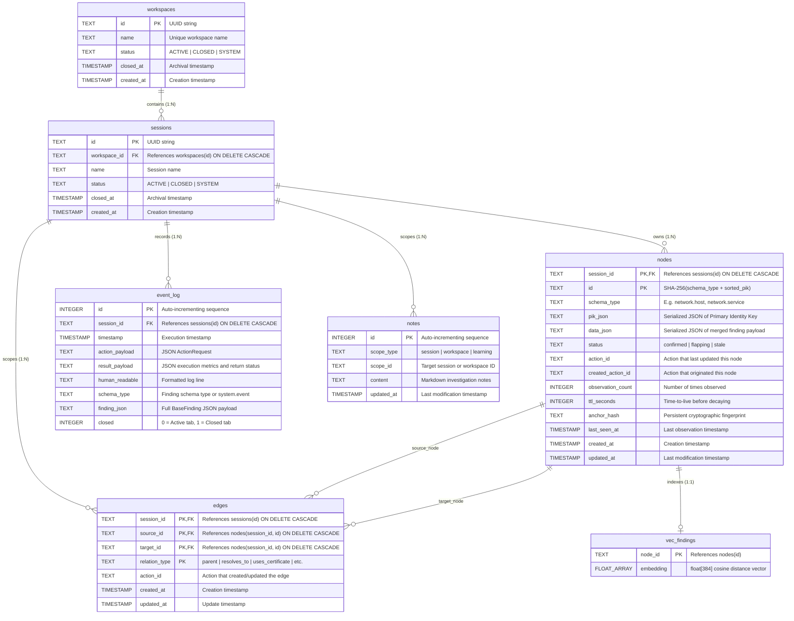

# Ether Database Architecture & Storage Specification

Welcome to the internal developer database specification for Ether. This document provides an exhaustive, authoritative guide to Ether's storage engine, relational schema, deterministic entity graph, Primary Identity Key (PIK) system, vector memory, state decay lifecycle, and cross-database portability mechanics.

---

## 1. Architectural Overview & Design Philosophies

Ether’s storage architecture is engineered to solve a core challenge in cybersecurity operations and autonomous agent loops: **tool fragmentation, stateful correlation, and investigation reproducibility**.

```text
┌────────────────────────────────────────────────────────────────────────┐
│                        Ether Runtime Storage                           │
├────────────────────────────────────────────────────────────────────────┤
│ Tool Adapters      -> Stream standardized BaseFinding objects          │
│ Repository Layer   -> Timeline & Graph Store abstractions              │
│ GraphStore Engine  -> Enforces PIKs, hashes IDs, auto-wires relations │
│ Vector Memory      -> sqlite-vec (vec0) 384-d cosine similarity RAG    │
│ SQLite WAL Layer   -> Relational entities, graphs, notes & event logs  │
│ Portability Subsys -> ATTACH/DETACH zero-copy encrypted session export │
└────────────────────────────────────────────────────────────────────────┘
```

### Core Design Tenets:

1. **Embedded & Zero-Configuration**: Powered by **SQLite 3** via asynchronous [`aiosqlite`](https://aiosqlite.omnilib.dev/). No external database servers, connection strings, or background daemons are required.
2. **Deterministic Entity Graph**: Security findings from disparate tools (`nmap`, `gobuster`, `nikto`, `whois`) are normalized and merged into a unified node graph using deterministic **Primary Identity Keys (PIKs)** and SHA-256 hashing.
3. **Idempotent Upsert & Non-Destructive Merging**: Subsequent scans against the same target update existing nodes rather than creating duplicate records, intelligently merging payload properties.
4. **Append-Only Event Sourcing**: Every tool execution, shell command, and finding is permanently recorded in an immutable `event_log` table, providing a complete audit trail and full session replayability.
5. **Embedded Vector Memory (`sqlite-vec`)**: Discovered services, web endpoints, technologies, and vulnerabilities are automatically indexed into 384-dimensional vector space (`vec0` virtual table) for sub-millisecond offline semantic similarity search and task-directed RAG.
6. **Temporal State Decay & Invariant Anchoring**: Nodes automatically transition across confidence states (`confirmed` -> `flapping` -> `stale`) based on TTL windows, while logical service identity is decoupled from volatile IPs via persistent cryptographic fingerprints (TLS cert SHA-256, SSH host keys).

---

## 2. Storage Topology & Runtime Locations

Ether manages database files across distinct locations depending on operational mode:

```text
~/.ether/ (or $ETHER_DATA_DIR, mode 0700)
├── ether.db           # Default global workspace & session database
├── logs/              # 64KB buffered subprocess raw output spools ({action_id}.log / .log.gz)
├── audit/             # Cryptographic session audit manifests ({session_id}.jsonl)
├── exports/           # Portable standalone or encrypted session archives
└── scratchpad.md      # Operator notes (mode 0600)
```

* **Uniform Runtime Database (`~/.ether/ether.db`)**: Created automatically on first launch in the user's unified application directory (mode `0o600`), regardless of which directory Ether is launched from.
* **Custom Database Override (`ether --db <path>`)**: Allows operators to bind Ether to a specific database file for engagement isolation.
* **Transient Testing (`:memory:`)**: All unit and integration test suites run against isolated in-memory databases with sub-millisecond setup and teardown.
* **Connection Lifecycle & Integrity Pragmas**:
  Connection management is encapsulated via `GraphStore.connection()`. Every active connection enforces security, concurrency, and durability pragmas:
  ```sql
  PRAGMA foreign_keys = ON;
  PRAGMA trusted_schema = OFF;
  PRAGMA busy_timeout = 5000;
  PRAGMA journal_mode = WAL;
  PRAGMA synchronous = NORMAL;
  ```

---

## 3. Entity-Relationship (ER) Architecture

The relational schema is composed of core relational tables and one virtual vector table:



---

## 4. Comprehensive Table Specifications

### 4.1. `workspaces` Table
The top-level operational boundary representing an organization, project, or engagement.

```sql
CREATE TABLE IF NOT EXISTS workspaces (
    id TEXT PRIMARY KEY,
    name TEXT NOT NULL,
    status TEXT DEFAULT 'ACTIVE',
    closed_at TIMESTAMP,
    created_at TIMESTAMP DEFAULT CURRENT_TIMESTAMP
);
```

### 4.2. `sessions` Table
A focused thread of investigation within a workspace.

```sql
CREATE TABLE IF NOT EXISTS sessions (
    id TEXT PRIMARY KEY,
    workspace_id TEXT NOT NULL,
    name TEXT NOT NULL,
    status TEXT DEFAULT 'ACTIVE',
    closed_at TIMESTAMP,
    created_at TIMESTAMP DEFAULT CURRENT_TIMESTAMP,
    FOREIGN KEY (workspace_id) REFERENCES workspaces(id) ON DELETE CASCADE
);
```

### 4.3. `nodes` Table (The Entity Graph)
Stores de-duplicated, stateful findings. Each row represents a discovered entity within a target network or system.

```sql
CREATE TABLE IF NOT EXISTS nodes (
    session_id TEXT NOT NULL,
    id TEXT NOT NULL,
    schema_type TEXT NOT NULL,
    pik_json TEXT NOT NULL,
    data_json TEXT NOT NULL,
    status TEXT DEFAULT 'confirmed',
    action_id TEXT,
    created_action_id TEXT,
    observation_count INTEGER DEFAULT 1,
    ttl_seconds INTEGER DEFAULT 3600,
    anchor_hash TEXT,
    last_seen_at TIMESTAMP DEFAULT CURRENT_TIMESTAMP,
    created_at TIMESTAMP DEFAULT CURRENT_TIMESTAMP,
    updated_at TIMESTAMP DEFAULT CURRENT_TIMESTAMP,
    PRIMARY KEY (session_id, id),
    FOREIGN KEY (session_id) REFERENCES sessions(id) ON DELETE CASCADE
);
```

| Column | Type | Constraints | Description |
| :--- | :--- | :--- | :--- |
| `session_id` | `TEXT` | `PK, FK` | References `sessions(id)` with `ON DELETE CASCADE`. |
| `id` | `TEXT` | `PK` | Deterministic 64-character hex SHA-256 hash calculated from `schema_type` and sorted `pik_json`. |
| `schema_type` | `TEXT` | `NOT NULL` | Standard schema identifier (e.g., `network.host`, `network.service`, `web.endpoint`). |
| `pik_json` | `TEXT` | `NOT NULL` | Serialized JSON dictionary of the Primary Identity Key fields. |
| `data_json` | `TEXT` | `NOT NULL` | Serialized JSON dictionary of entity attributes. Merged non-destructively on subsequent upserts. |
| `status` | `TEXT` | `DEFAULT 'confirmed'` | State decay flag: `'confirmed'` (fresh), `'flapping'` (oscillating), or `'stale'` (decayed). |
| `action_id` | `TEXT` | `NULLABLE` | UUID of the action that last modified this entity. |
| `created_action_id` | `TEXT` | `NULLABLE` | UUID of the action that originally discovered this entity. |
| `observation_count` | `INTEGER` | `DEFAULT 1` | Cumulative counter tracking how many times this finding has been re-observed. |
| `ttl_seconds` | `INTEGER` | `DEFAULT 3600` | Duration in seconds before the finding begins temporal state decay. |
| `anchor_hash` | `TEXT` | `NULLABLE` | Cryptographic fingerprint (e.g. `tls:<sha256>`, `ssh:<fingerprint>`, `favicon:<hash>`). |
| `last_seen_at` | `TIMESTAMP` | `DEFAULT CURRENT_TIMESTAMP` | Timestamp of the most recent active observation. |
| `created_at` | `TIMESTAMP` | `DEFAULT CURRENT_TIMESTAMP` | Initial entity discovery timestamp. |
| `updated_at` | `TIMESTAMP` | `DEFAULT CURRENT_TIMESTAMP` | Timestamp of the most recent upsert or property merge. |

### 4.4. `edges` Table (Relationships & Topology)
Stores directed relationships connecting nodes within an entity graph.

```sql
CREATE TABLE IF NOT EXISTS edges (
    session_id TEXT NOT NULL,
    source_id TEXT NOT NULL,
    target_id TEXT NOT NULL,
    relation_type TEXT NOT NULL,
    action_id TEXT,
    created_at TIMESTAMP DEFAULT CURRENT_TIMESTAMP,
    updated_at TIMESTAMP DEFAULT CURRENT_TIMESTAMP,
    PRIMARY KEY (session_id, source_id, target_id, relation_type),
    FOREIGN KEY (session_id, source_id) REFERENCES nodes(session_id, id) ON DELETE CASCADE,
    FOREIGN KEY (session_id, target_id) REFERENCES nodes(session_id, id) ON DELETE CASCADE
);
```

### 4.5. `event_log` Table (The Audit Trail)
An append-only log capturing every command execution, tool output, and generated finding.

```sql
CREATE TABLE IF NOT EXISTS event_log (
    id INTEGER PRIMARY KEY AUTOINCREMENT,
    session_id TEXT NOT NULL,
    timestamp TIMESTAMP DEFAULT CURRENT_TIMESTAMP,
    action_payload TEXT,
    result_payload TEXT,
    human_readable TEXT,
    schema_type TEXT,
    finding_json TEXT,
    closed INTEGER DEFAULT 0,
    FOREIGN KEY (session_id) REFERENCES sessions(id) ON DELETE CASCADE
);
```

### 4.6. `notes` Table
Persistent investigation notes attached to sessions or workspaces.

```sql
CREATE TABLE IF NOT EXISTS notes (
    id INTEGER PRIMARY KEY AUTOINCREMENT,
    scope_type TEXT NOT NULL,
    scope_id TEXT NOT NULL,
    content TEXT,
    updated_at TIMESTAMP DEFAULT CURRENT_TIMESTAMP
);
```

### 4.7. `vec_findings` Virtual Table (`sqlite-vec`)
Embedded 384-dimensional vector virtual table powered by `sqlite-vec` (`vec0`) for natural language semantic similarity search.

```sql
CREATE VIRTUAL TABLE IF NOT EXISTS vec_findings USING vec0(
    node_id text primary key,
    embedding float[384] distance_metric=cosine
);
```

---

## 5. Vector Memory & Finding RAG Engine

Ether embeds `sqlite-vec` directly inside SQLite to provide sub-millisecond offline finding retrieval with zero network egress and zero external API dependencies.

1. **Deterministic Vector Generation**:
   `VectorEmbeddingEngine` maps the finding's `.to_semantic_text()` output into a 384-dimensional unit vector ($||v||_2 = 1.0$) via multi-hash signed random projections (3 projections per unigram, 2 per bigram, 4-grams for subword robustness).
2. **Synchronized Upsert & Deletion**:
   When findings are ingested via `store.upsert_findings_batch()`, corresponding rows in `vec_findings` are updated. When stale nodes are pruned or sessions are deleted, vector embeddings are automatically purged.
3. **k-NN Cosine Distance Search**:
   Queries are executed using `vec0`'s native k-NN vector match syntax:
   ```sql
   SELECT n.*, sub.distance
   FROM (
       SELECT node_id, distance
       FROM vec_findings
       WHERE embedding MATCH ? AND k = ?
   ) sub
   JOIN nodes n ON sub.node_id = n.id
   WHERE n.session_id = ? AND n.status != 'stale'
   ORDER BY sub.distance ASC LIMIT ?;
   ```
   Cosine similarity is computed as `similarity = 1.0 - distance`.

---

## 6. Temporal State Decay & Invariant Identity Anchoring

1. **Confidence Windows & Adaptive Volatility Scoring**:
   - `confirmed`: Active and observed within the effective `ttl_seconds`.
   - `flapping`: Observed across multiple non-consecutive runs or undergoing frequent state oscillation.
   - `stale`: Age exceeds effective `ttl_seconds` without fresh observation. Excluded from standard queries by default.
   - `TemporalDecayEngine` computes an adaptive volatility coefficient ($V_n \in [0.1, 1.0]$) from historical flapping frequency and restart intervals, accelerating decay for high-churn cloud/container targets while preserving long confidence windows for stable hosts. Metadata-only volatility updates leave `updated_at` untouched.
2. **Cross-IP Identity Migration**:
   When a service shifts IP addresses (e.g. in dynamic cloud or container environments), its Primary Identity Key changes. By anchoring nodes to invariant cryptographic fingerprints (`tls:<sha256>`, `ssh:<fingerprint>`, `favicon:<hash>`), `GraphStore` automatically discovers previous instances, creates directed `anchored_identity` migration edges, and marks the old ephemeral node as stale.

---

## 7. Session Portability: Export & Import Architecture

Ether implements cross-machine session sharing using zero-copy SQLite database attachment and optional authenticated encryption (Argon2id + AES-256-GCM).

```bash
# Export session with authenticated encryption
ether graph export <SESSION_ID> -o session.enc --encrypt --passphrase "Secret123"

# Import encrypted session archive into a new database
ether graph import session.enc --passphrase "Secret123" --session-id <NEW_SESSION_ID>
```

---

## 8. High-Concurrency Async Write Serialization & Read Connection Pooling

In high-concurrency multi-agent environments where 50+ autonomous subagents simultaneously emit findings into SQLite, SQLite's single-writer architecture can cause write lock contention (`sqlite3.OperationalError: database is locked`) despite WAL journal mode and `busy_timeout` configurations.

Ether solves this through an in-memory asynchronous serialization queue and dedicated connection pooling in `GraphStore`:

```text
┌────────────────────────────────────────────────────────────────────────┐
│                   GraphStore Concurrency Architecture                  │
├────────────────────────────────────────────────────────────────────────┤
│  Concurrent Coroutines (50+ Agents)                                    │
│    │               │               │                                   │
│    ▼               ▼               ▼                                   │
│  upsert_finding  create_session  append_event                          │
│    │               │               │                                   │
│    └───────────────┼───────────────┘                                   │
│                    ▼                                                   │
│         [ asyncio.Queue (Write Queue) ]                                │
│                    │                                                   │
│                    ▼ (Batches: 50 ops or 25ms timeout window)          │
│       [ Dedicated Async Writer Worker ]                                │
│                    │                                                   │
│                    ▼ (Single Write Connection: BEGIN IMMEDIATE ... )   │
│         [ SQLite WAL Database File ] ◄── [ Read Connection Pool ]      │
│                                           (PRAGMA query_only = ON)     │
└────────────────────────────────────────────────────────────────────────┘
```

### Key Concurrency Mechanics:
1. **Single-Writer Worker Task**: A single persistent background coroutine (`_writer_loop`) owns the exclusive write connection, completely serializing write transactions and eliminating SQLite lock contention.
2. **Adaptive Transaction Batching**: The worker batches pending write operations—committing either every **50 operations** or every **25ms window** inside a single `BEGIN IMMEDIATE ... COMMIT` block—increasing write throughput by up to 20x under heavy load.
3. **Per-Caller Completion Futures**: Every enqueued write operation is paired with an `asyncio.Future`, allowing callers to await durable completion with full sequential consistency and immediate exception bubbling.
4. **Isolated Read Connection Pool**: Read operations (`get_all_nodes`, `search_findings`, `list_sessions`) acquire connections from an asynchronous connection pool configured with `PRAGMA query_only = ON;` and `busy_timeout = 5000`, guaranteeing that readers never wait on serialized write queues.
5. **Graceful Drain on Teardown**: Calling `await store.close()` cleanly drains all pending operations in the write queue and resolves all outstanding caller futures before closing write and read connections.

